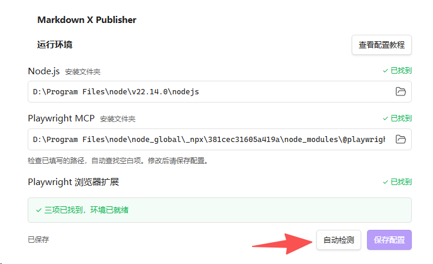
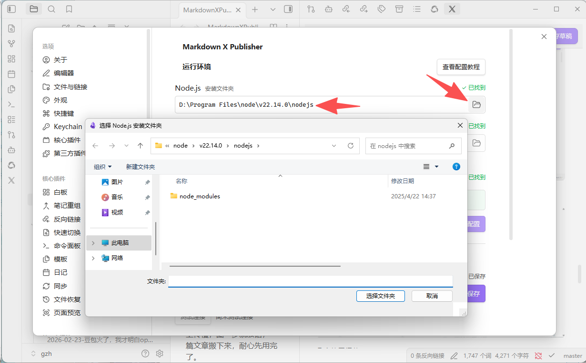
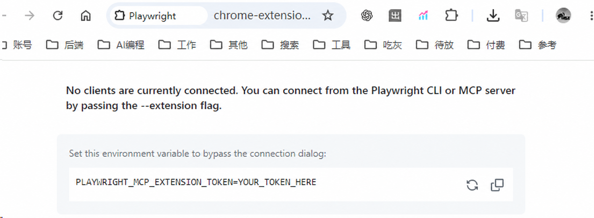
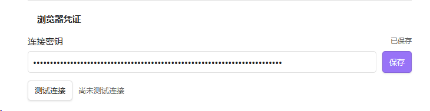
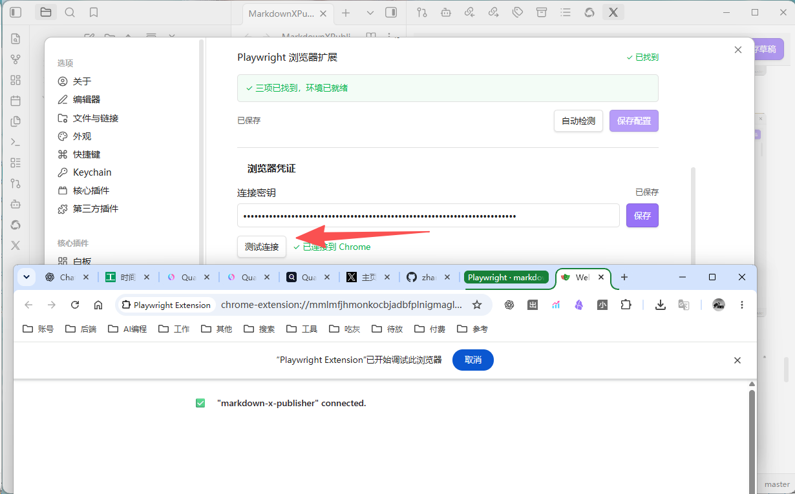

# Markdown X Publisher

[简体中文](README.md)

Save Obsidian notes as X Article drafts.

Preview the content in Obsidian, adjust the title, and choose a cover. The plugin uploads body images and saves the draft automatically. You can then continue editing and publish it in X.


*Captured in Obsidian: edit the sample article on the left, review the plugin preview on the right, and save it as an X draft. The interface is currently in Chinese.*

## Features

- **Article preview**: review the converted content, with automatic preview updates as you edit the note.
- **Image uploads**: supports vault images, Obsidian image embeds, and directly downloadable online images.
- **Cover cropping**: choose an image from the article or your computer, then drag, zoom, and crop it to a 5:2 cover.
- **Use your existing login**: connects to your regular Chrome profile and uses its signed-in X account.
- **Continue after an interruption**: if saving fails, continue working with the existing draft and uploaded images in the current dialog.

The plugin is free and open source. It requires no X Developer API key or AI service. It only saves drafts; you publish them manually in X.

## Requirements

- Desktop Obsidian **1.11.7 or later**.
- Google Chrome.
- Node.js **18 or later**.
- The official Playwright MCP and Chrome extension, installed as described below.
- An X account signed in to Chrome with permission to create Articles. See [X's official requirements](https://help.x.com/en/using-x/articles).

Obsidian mobile is currently unsupported.

## Installation

### Install from Community plugins

1. Open Obsidian **Settings → Community plugins**.
2. Select **Browse** and search for **Markdown X Publisher**.
3. Select **Install**, then **Enable**.
4. Follow **First-time setup** below to connect your browser.

You can also select **Add to Obsidian** on the [plugin directory page](https://community.obsidian.md/plugins/markdown-x-publisher) to start installation.

### Manual installation

1. Download `markdown-x-publisher-<version>.zip` from [GitHub Releases](https://github.com/zhangloveyan/obsidian-to-x/releases/latest).
2. Extract it and place the `markdown-x-publisher` folder in your vault's `.obsidian/plugins/` directory.
3. Reload Obsidian and enable **Markdown X Publisher** under **Settings → Community plugins**.

The installed directory should look like this:

```text
Your vault/
└── .obsidian/
    └── plugins/
        └── markdown-x-publisher/
            ├── main.js
            ├── manifest.json
            ├── styles.css
            ├── LICENSE
            └── THIRD_PARTY_NOTICES.md
```

To update manually, replace the plugin files and keep your existing `data.json`.

## First-time setup

### 1. Install Node.js

Open the [official Node.js download page](https://nodejs.org/en/download) and select **LTS (Long Term Support)**:

- **Windows**: download the `.msi` installer, open it, and follow the prompts with the default options.
- **macOS**: download the `.pkg` installer, open it, and follow the prompts.
- **Linux**: follow the download page's instructions for your system.

### 2. Install Playwright MCP

On Windows, press **Win + R**, enter `cmd`, and press Enter. On macOS or Linux, open Terminal. Copy and paste this command into the window, press Enter, and wait for installation to finish:

```sh
npm install -g @playwright/mcp@0.0.83
```

### 3. Install the Chrome extension

Using the Chrome profile you normally use for X, open the [Playwright extension in the Chrome Web Store](https://chromewebstore.google.com/detail/playwright-extension/mmlmfjhmonkocbjadbfplnigmagldckm). Select **Add to Chrome** and follow the installation prompts.

Open Chrome's **Extensions** menu (the puzzle icon at the top right) and select Playwright. Sign in to X in the same Chrome profile and confirm that you can create an Article. See the [official extension instructions](https://github.com/microsoft/playwright/blob/main/packages/extension/README.md) for details.

Once all three components are installed, return to the plugin settings in Obsidian and select **Auto-detect (自动检测)**. Both path fields are empty on first use, and no search starts until you select the button. Detected Node.js and Playwright MCP installation folders are then filled in. Once both show **Found (已找到)**, select **Save configuration (保存配置)**.



Entered paths are checked without being replaced; only empty fields are filled automatically. You can also type a folder path or select one with the **folder icon**.



Paths take effect after saving; a failed save keeps the previous configuration active. If a newly installed component is not found, restart Obsidian and detect again, or select **View setup tutorial (查看配置教程)** for help.

Once both paths are saved, reopening settings automatically checks those locations and the extension to update their status. This does not rewrite paths, overwrite your edits or start a Chrome connection.

For the extension, **Found** only confirms that installation files were located. Step 5 checks the actual connection. You can save the Node.js and MCP paths even if the extension is not found.

### 4. Copy and save the connection token

1. Open the Playwright extension's status page in Chrome.
2. Copy the value of `PLAYWRIGHT_MCP_EXTENSION_TOKEN`.
3. In the plugin settings, paste it into **Browser credential (浏览器凭证) → Connection token (连接密钥)** and select **Save (保存)**.



*The token in this screenshot has been replaced with example text. Copy the token from your own extension.*



Obsidian's secret storage manages the token. Save one token and reuse it for subsequent articles. If your Chrome profile or extension token changes, update and save it in the same field.

### 5. Test the connection

Keep Chrome open and select **Test connection (测试连接)**. Setup is complete when **Connected to Chrome (已连接到 Chrome)** appears.



**Saved** does not mean connected. Save changes to the runtime configuration or token before testing. The test only checks the Chrome connection; it does not create an article or verify X login status or Article permissions.

After a successful test in the current plugin session, reopening settings shows **Last test passed (上次测试通过)** as a record of that result. Restarting Obsidian or reloading the plugin clears the result; an existing token then shows **Token saved; ready to test (密钥已保存，可测试连接)**. Saving a different path or token also clears the old result, so test again after such a change.

## Usage

1. Open a Markdown note.
2. Click the **X icon** in Obsidian's ribbon, or run **Preview X article (预览 X 文章)**.
3. Review the preview and select **Save draft (保存草稿)**.
4. Confirm the title and optionally choose and crop a cover.
5. Select **Save to draft (保存到草稿)** and wait for completion.
6. Review the draft in X, then continue editing or publish it manually.

You can also open the save dialog with **Save to X draft (保存到 X 草稿)** or a Markdown file's context menu.

Each save creates a new draft. Title and cover changes in the save dialog do not modify the source note.


*The dialog screenshots use sample content in a local demo of the current plugin UI.*

### Title

The default title is the first level-one heading in the note's body. If there is no level-one heading, the filename is used.

The heading used as the article title is removed from the body to avoid repetition. You can also change the title for the current draft in the save dialog.

### Cover

A cover is optional. You can choose one from:

- **Article images (文章图片)**: images in the current note.
- **Local images (本地图片)**: an image on your computer.


After selecting an image, select **Confirm (确认)** to open the crop dialog:

- The crop ratio is fixed at **5:2**.
- A new image starts centered at the minimum zoom needed to fill the crop frame.
- Drag the image to adjust its position, and use the slider or plus/minus buttons to zoom.
- Select **Apply (应用)** to confirm, or go back to choose another image.


The crop is exported as a separate PNG without changing the original image or body images. GIF and animated WebP covers use the first frame. Selecting **Re-crop (重新裁剪)** in the current save dialog preserves the previous crop selection.

## Supported formats

| Content | Handling |
| --- | --- |
| Paragraphs, Chinese text, emoji, Markdown links | Converted to X Article content |
| Bold, italic, strikethrough | Text styles preserved |
| Body headings | Converted to X headings; deeper levels are folded into the second level |
| Simple quotes, unordered lists, simple ordered lists starting at 1 | Converted to native X text blocks |
| Single-level lists containing images or multiple paragraphs | Converted in order to paragraphs with explicit numbers or bullets and separate images; visible numbering is preserved, but X no longer auto-numbers these paragraphs |
| Code blocks, tables, nested and other complex lists | Preserved as Markdown content blocks; images that cannot be extracted produce an error with source context |
| Markdown images, `![[image.png]]` | Uploaded as body images |
| Vault images, HTTP(S) images | Supported; online images must be directly downloadable |

Supported image formats are **PNG, JPEG, GIF, and WebP**, with a limit of **20 MB** per image.

Obsidian `%% comments %%` and HTML comments outside code are excluded from both the preview and uploaded content.

Rendering from Dataview, complex HTML, custom fonts, and other plugins is not guaranteed to be preserved. Video uploads are not supported. Images in some complex structures need to be moved into separate paragraphs before saving. Check the final layout in the X draft.

## Troubleshooting

| Situation | Explanation and action |
| --- | --- |
| The page reloads automatically | The plugin reloads the draft to verify the body, images, and saved result. This is part of the normal workflow. |
| Saving an article with many images is slow | Images upload one at a time. The time needed depends on their number, size, and network speed. Wait for the progress messages. |
| Saving is interrupted | If **Continue current draft (继续当前草稿)** appears, keep the save dialog and corresponding X draft page open. Resolve the reported issue, then continue. |
| Chrome cannot connect | Check that the extension is enabled and the credential comes from the current Chrome profile, then test the connection again. |
| You need to report a problem | Select **View log (查看日志)** or run **View problem log (查看问题日志)**. Copy the log and submit an [Issue](https://github.com/zhangloveyan/obsidian-to-x/issues). |

Continuation progress is stored only in the current dialog. Closing it or restarting Obsidian discards that progress, but any X draft already created remains available on the website.

A new save or connection test replaces the previous problem log. Copy it before retrying if you need it for a report.

## Privacy and data access

- The plugin reads the current note and its referenced images. It reads only the local cover file you select.
- Saving sends article content and images to X. Loading online images contacts their source websites.
- Obsidian manages the browser credential. It is not written to the plugin configuration file or problem logs.
- The plugin launches your locally installed Playwright MCP to connect to Chrome. It does not install the runtime automatically.
- Extension detection looks only for installed extension files in Chrome's usual locations. It does not read browsing history, account details, or login credentials.
- Problem logs are stored locally and omit the body, title, image data, and connection credential. MCP's temporary operation files may contain webpage content.
- The plugin contains no telemetry, advertising, or AI service calls.

The plugin depends on X's website and may need an update when X changes its interface.

## Development

```sh
npm ci
npm run dev
```

Run checks and generate the installable package:

```sh
npm run package
```

Installation files are generated in `dist/markdown-x-publisher/`.

[Implementation notes](docs/implementation-plan.md) · [Validation record](docs/validation.md) · [Release instructions](docs/releasing.md)

## License

Copyright © 2026 Ancle.

This project is licensed under [AGPL-3.0-only](LICENSE). Third-party dependencies retain their respective licenses; see [third-party notices](THIRD_PARTY_NOTICES.md).
