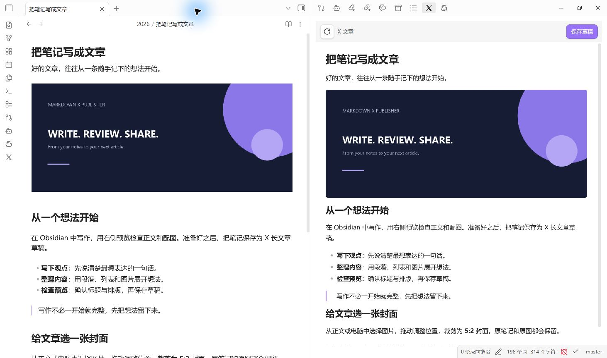
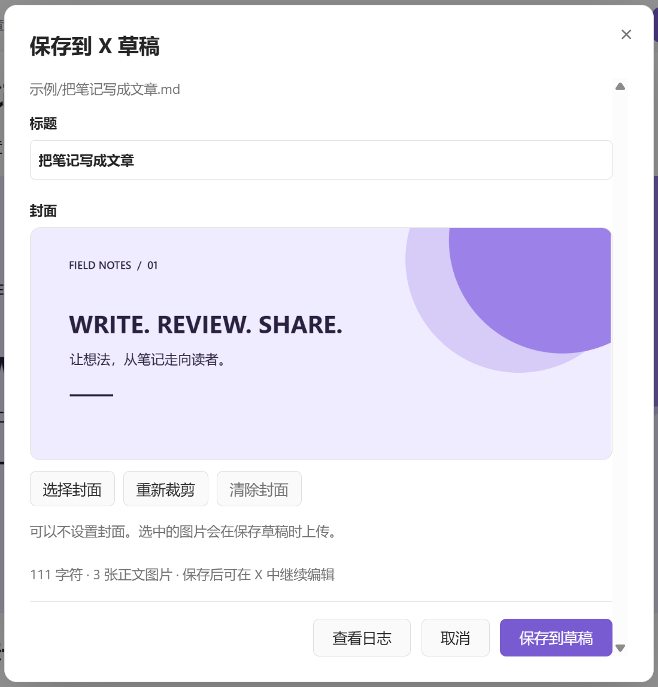
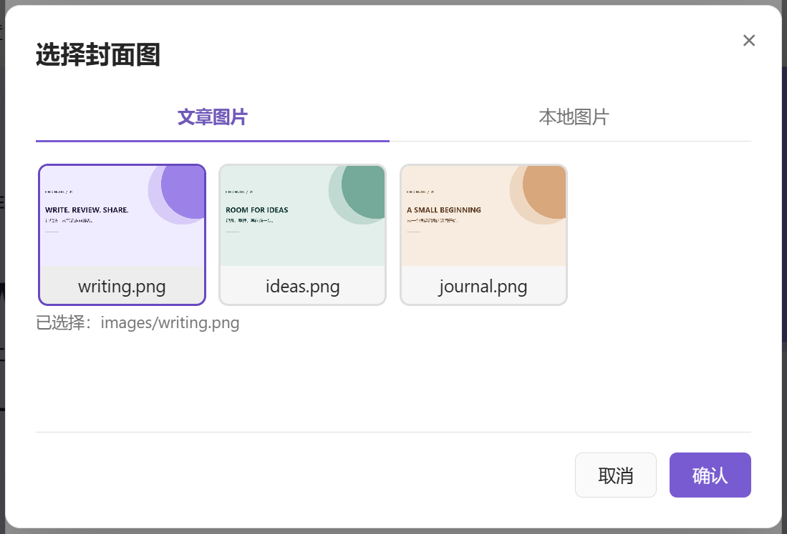
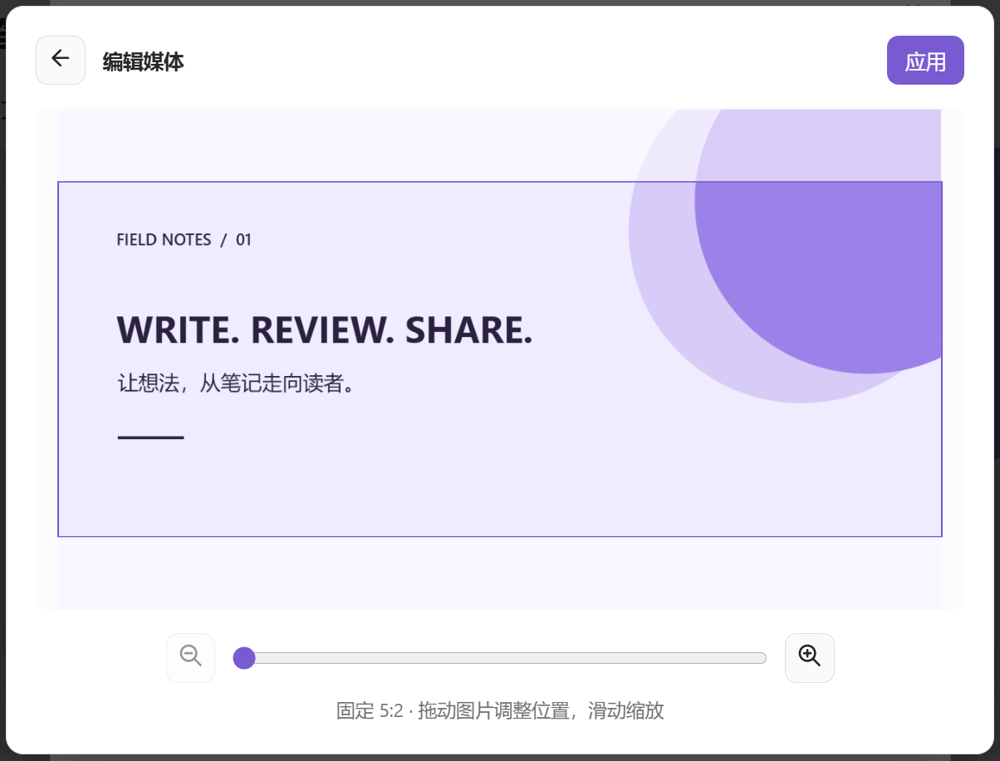

# Markdown X Publisher

[English](README.en.md)

把 Obsidian 笔记保存为 X 长文章草稿。

在 Obsidian 中预览内容、调整标题、选择封面，插件自动上传正文图片并保存草稿。完成后，你可以在 X 中继续编辑和发布。



*Obsidian 实际使用界面：左侧是示例文章，右侧是插件预览，可直接保存为 X 草稿。*

## 功能

- **文章预览**：查看转换后的正文，编辑笔记时可自动刷新预览。
- **图片上传**：支持笔记库图片、Obsidian 图片嵌入和可直接下载的网络图片。
- **封面裁剪**：从正文或电脑中选择图片，拖动、缩放并裁剪为 5:2 封面。
- **沿用登录状态**：连接日常使用的 Chrome，使用其中已登录的 X 账号。
- **中断后继续**：保存失败时，可在当前窗口中继续处理已有草稿和已上传图片。

插件免费开源，无需 X 开发者 API key 或 AI 服务。插件只保存草稿，公开发布由你在 X 中完成。

## 使用条件

- 桌面版 Obsidian **1.11.7 或更新版本**。
- Google Chrome。
- Node.js **18 或更新版本**。
- 官方 Playwright MCP 和 Chrome 扩展，安装步骤见下文。
- 已登录 X，且账号具备创建 Articles 的权限。账号要求见 [X 官方说明](https://help.x.com/en/using-x/articles)。

目前不支持 Obsidian 移动端。

## 安装

### 从插件市场安装

1. 打开 Obsidian **设置 → 第三方插件**。
2. 点击 **浏览**，搜索 **Markdown X Publisher**。
3. 点击 **安装**，完成后点击 **启用**。
4. 按下方的 **首次配置** 完成浏览器连接。

也可以从 [插件市场页面](https://community.obsidian.md/plugins/markdown-x-publisher) 点击 **Add to Obsidian**，进入安装流程。

### 手动安装

1. 从 [GitHub Releases](https://github.com/zhangloveyan/obsidian-to-x/releases/latest) 下载 `markdown-x-publisher-<version>.zip`。
2. 解压，将其中的 `markdown-x-publisher` 文件夹放入笔记库的 `.obsidian/plugins/`。
3. 重新加载 Obsidian，在 **设置 → 第三方插件** 中启用 **Markdown X Publisher**。

安装后的目录应为：

```text
你的笔记库/
└── .obsidian/
    └── plugins/
        └── markdown-x-publisher/
            ├── main.js
            ├── manifest.json
            ├── styles.css
            ├── LICENSE
            └── THIRD_PARTY_NOTICES.md
```

更新时覆盖插件文件即可，保留已有的 `data.json`。

## 首次配置

### 1. 安装运行环境

安装 [Node.js](https://nodejs.org/en/download) 的 **LTS（长期支持版）**。Windows 用户按 **Win + R**，输入 `cmd` 并按回车；macOS 或 Linux 用户打开终端，然后运行：

```sh
npm install -g @playwright/mcp@0.0.83
```

首次打开插件设置时，两个安装文件夹输入框为空。点击 **自动检测**，插件找到 Node.js 和 Playwright MCP 后会填入文件夹路径；确认两项均显示“已找到”，再点击 **保存配置**。保存成功后，再次打开设置会保留这些路径。

也可以直接输入路径，或点击输入框右侧的**文件夹图标**选择安装文件夹，取消选择不会改动路径。**自动检测只检查已填写的位置，空白项才会自动查找并填入**。想重新查找某一项，先清空那一项再检测。

输入、选择或自动找到的路径都要点击 **保存配置** 后才会生效。保存时会检查两个目录；失败时保留输入，原有配置继续有效。如果刚安装 Node.js 后仍未检测到，请重启 Obsidian。详细操作和路径填写示例见设置中的 **查看配置教程**。

### 2. 安装 Chrome 扩展

用 Chrome 打开 [Playwright 扩展商店页面](https://chromewebstore.google.com/detail/playwright-extension/mmlmfjhmonkocbjadbfplnigmagldckm)，点击 **添加至 Chrome**。电脑上的 Playwright MCP 和浏览器扩展都需要安装；设置中的 **查看配置教程** 提供了安装入口与步骤。

安装后，点击 Chrome 工具栏的 **扩展程序**（拼图图标），打开 Playwright 扩展。更多说明见 [Playwright 官方扩展文档](https://github.com/microsoft/playwright/blob/main/packages/extension/README.md)。

在同一个 Chrome 用户配置中登录 X，并确认可以新建长文章。

点击 **自动检测** 也会查找 Chrome 中已安装的 Playwright 扩展文件。扩展显示“已找到”，只表示找到了安装文件；是否已启用、密钥是否有效以及能否连接 Chrome，都由后面的 **测试连接** 确认。未找到扩展时仍可保存 Node.js 和 MCP 路径。

### 3. 连接浏览器

1. 打开 Chrome 中 Playwright 扩展的状态页。
2. 复制 `PLAYWRIGHT_MCP_EXTENSION_TOKEN` 对应的密钥值。
3. 回到插件设置，在 **浏览器凭证 → 连接密钥** 中粘贴密钥，点击 **保存**。
4. 保持 Chrome 打开，点击 **测试连接**；显示“已连接到 Chrome”后完成配置。

**保存密钥与测试连接是两个独立操作。** “已保存”表示密钥已保存，并不表示已经连上 Chrome。修改运行环境或密钥后，请先保存，再测试连接。测试只检查浏览器连接，不会创建文章，也不检查 X 登录状态或长文章权限。

只需保存一个有效密钥，无需选择或切换密钥列表，也不用为每篇文章重新填写。切换 Chrome 用户配置或扩展密钥变化后，在同一输入框更新并保存即可。凭据由 Obsidian 密钥存储管理；配置有效后，后续连接无需逐次点击允许。

## 使用

1. 打开一篇 Markdown 笔记。
2. 点击 Obsidian 侧栏的 **X 图标**，或运行 **预览 X 文章** 命令。
3. 检查预览，点击 **保存草稿**。
4. 确认标题，按需选择和裁剪封面。
5. 点击 **保存到草稿**，等待完成。
6. 在 X 中检查草稿，继续编辑或手动发布。

也可以通过 **保存到 X 草稿** 命令，或 Markdown 文件的右键菜单直接打开保存窗口。

每次保存都会新建一篇草稿。保存窗口中对标题和封面的调整不会改写原笔记。



*以下弹窗截图使用示例内容，来自当前插件界面的本地演示环境。*

### 标题

默认使用笔记正文中的第一个一级标题；没有一级标题时，使用文件名。

被用作文章标题的一级标题会从正文中移除，避免重复显示。你也可以在保存窗口中修改本次草稿的标题。

### 封面

封面可不设置，也可以从以下位置选择：

- **文章图片**：使用当前笔记中的图片。
- **本地图片**：从电脑中选择图片。



选择后点击 **确认**，进入裁剪窗口：

- 裁剪比例固定为 **5:2**。
- 新图片默认居中，以最小比例铺满裁剪框。
- 拖动图片调整位置，使用滑杆或加减按钮缩放。
- 点击 **应用** 确认，也可返回重新选择。



裁剪结果是独立的 PNG，不修改原图或正文图片。GIF 和动态 WebP 用作封面时取首帧。在当前保存窗口中点击 **重新裁剪**，会保留上次选区。

## 格式支持

| 内容 | 处理方式 |
| --- | --- |
| 段落、中文、emoji、Markdown 链接 | 转换为 X 文章内容 |
| 粗体、斜体、删除线 | 保留文字样式 |
| 正文标题 | 转换为 X 标题；较深层级折叠为第二级 |
| 简单引用、无序列表、从 1 开始的简单有序列表 | 转换为 X 原生文本块 |
| 包含图片或多个段落的单层列表 | 按顺序转换为带编号或圆点的普通段落与独立图片，保留可见编号；在 X 中不再自动续号 |
| 代码块、表格、嵌套等其他复杂列表 | 以 Markdown 内容块保留；其中无法单独提取的图片会提示具体原文位置 |
| Markdown 图片、`![[图片.png]]` | 上传为正文图片 |
| 笔记库图片、HTTP(S) 图片 | 支持，网络图片需能直接下载 |

图片支持 **PNG、JPEG、GIF、WebP**，单张上限 **20 MB**。

代码以外的 Obsidian `%% 注释 %%` 和 HTML 注释不会进入预览或上传内容。

Dataview、复杂 HTML、自定义字体和其他插件的渲染效果不保证保留；暂不支持视频上传。部分复杂结构中的图片需要移到单独段落后再保存。最终排版请以 X 中的草稿为准。

## 保存过程中遇到问题

| 情况 | 说明与处理 |
| --- | --- |
| 页面自动刷新 | 插件会重新载入草稿，核对正文、图片和保存结果，属于正常流程。 |
| 图片较多，保存较慢 | 图片逐张上传，耗时取决于数量、大小和网络速度，请等待进度提示。 |
| 保存中断 | 如果出现 **继续当前草稿**，保留保存窗口和对应的 X 草稿页，处理提示后继续。 |
| 无法连接 Chrome | 检查扩展是否启用、连接凭据是否来自当前 Chrome 用户配置，再测试连接。 |
| 需要反馈故障 | 点击 **查看日志**，或运行 **查看问题日志** 命令，复制日志后提交 [Issue](https://github.com/zhangloveyan/obsidian-to-x/issues)。 |

继续保存的进度只保存在当前窗口中。关闭窗口或重启 Obsidian 后，无法恢复这份进度，但已经创建的 X 草稿仍可在网页中查看。

重新保存或测试连接会替换上一轮问题日志，反馈前请先复制。

## 隐私与数据访问

- 插件读取当前笔记及其引用的图片，本地封面只读取你选择的文件。
- 保存时，文章内容和图片发送到 X；加载网络图片时会访问图片来源网站。
- 浏览器连接凭据由 Obsidian 管理，不写入插件配置文件或问题日志。
- 插件启动本机已安装的 Playwright MCP 来连接 Chrome，不自动安装运行环境。
- 扩展检测只查找 Chrome 常见安装位置中的扩展文件，不读取浏览器历史、账号或登录凭据。
- 问题日志仅保存在本地，不记录正文、标题、图片数据或连接凭据。MCP 的临时操作文件可能包含网页内容。
- 不包含遥测、广告或 AI 服务调用。

插件依赖 X 网页运行，X 更新界面后可能需要适配更新。

## 开发

```sh
npm ci
npm run dev
```

检查并生成安装包：

```sh
npm run package
```

安装文件生成于 `dist/markdown-x-publisher/`。

[实现说明](docs/implementation-plan.md) · [验证记录](docs/validation.md) · [发布说明](docs/releasing.md)

## 许可证

Copyright © 2026 Ancle。

本项目使用 [AGPL-3.0-only](LICENSE) 许可证。第三方依赖遵循各自许可证，详见 [第三方声明](THIRD_PARTY_NOTICES.md)。
